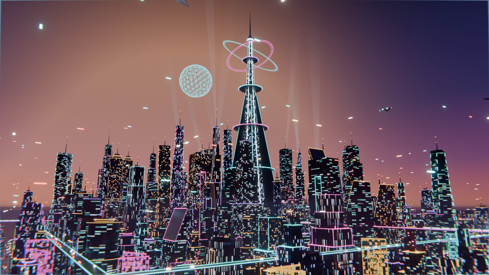
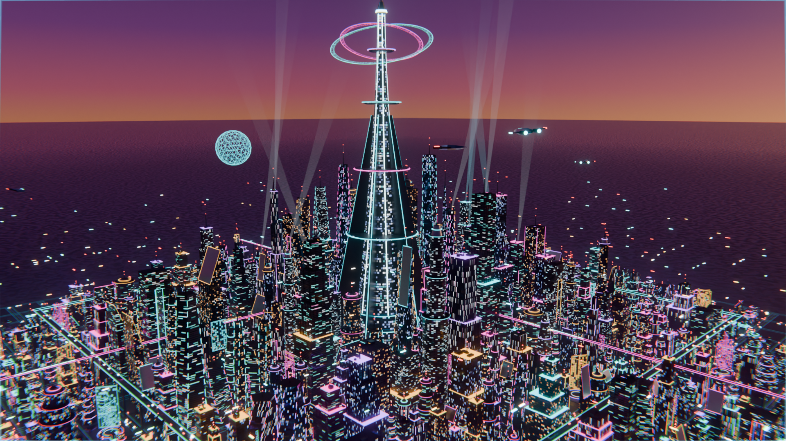
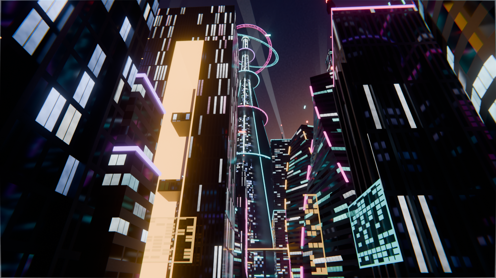

# Nexus Prime — procedural technocity for Blender

A fully procedural, ultra-futuristic city scene. One Python script generates all
geometry, shaders, lighting, atmosphere, cameras and the compositing grade — no
external assets or textures.

| Hero | Aerial | Street |
| --- | --- | --- |
|  |  |  |

## What is in the scene

- **~1,000 towers** on a 2 km street grid, drawn from seven archetypes: stepped
  setback towers, cylindrical towers, twisted towers with neon seams, tapered
  spires with buttress fins, twin "gate" towers, raked blade slabs and low
  industrial clusters. Heights follow a skyline profile with a second
  financial cluster so the silhouette is not radially symmetric.
- **The Nexus megaspire** — a 1 km arcology with buttresses, sky-decks, halo
  rings, holographic orbital rings and a sky beam.
- **Infrastructure** — two elevated expressway loops, four maglev spines with
  trains, sky-bridges between neighbouring towers, landing-pad plazas.
- **Traffic** — street traffic, expressway traffic and stacked air corridors as
  light streaks, plus ten modelled flying craft.
- **Shaders** — procedural curtain-wall material (window grid, mullions,
  per-window lighting, clustered occupancy, mirror glazing), rain-slick
  asphalt, neon, holographic signage with glyphs and scanlines, light shafts.
- **Atmosphere** — dusk sky with sun glow and stars, volumetric haze and
  street-level smog, searchlights, bloom and slight chromatic dispersion.

## Usage

Open `technocity.blend` in Blender 5.x, or regenerate everything:

```bash
blender -b -P technocity.py -- --render hero aerial street --save technocity.blend
```

It also runs without the Blender application, using the `bpy` module:

```bash
pip install bpy
```

```bash
python technocity.py --render hero --res 1920 1080 --samples 72
```

| Option | Default | Meaning |
| --- | --- | --- |
| `--seed N` | `7` | Layout seed; every seed is a different city |
| `--render CAM…` | none | Any of `hero`, `aerial`, `street` |
| `--res W H` | `1920 1080` | Output resolution |
| `--samples N` | `160` | Cycles samples (denoised with OpenImageDenoise) |
| `--out DIR` | `renders/` | Where stills are written |
| `--save PATH` | none | Save the generated scene as a `.blend` |

The scene is organised into collections (`Environment`, `Buildings`, `Nexus`,
`Infrastructure`, `Traffic`, `FX`, `Cameras`). Renders use Cycles; a 1080p
frame takes roughly 10–15 minutes on a 4-core CPU and far less on a GPU.
